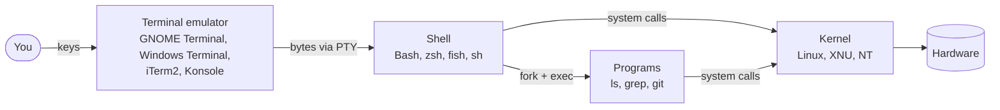
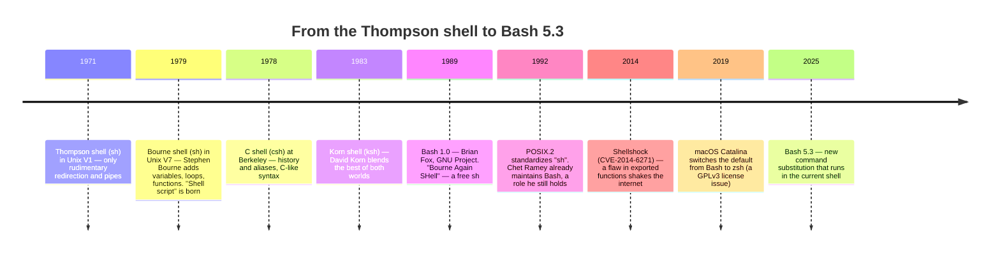

# Module 00 — Welcome & Fundamentals

> *"Before typing your first command, understand who you're talking to."*

**🌍 Idioma / Language:** [Português](README.md) · **English**

**Suggested time:** 3–4 h · **Level:** absolute zero · **Prerequisite:** none

## 🎯 By the end of this module you'll be able to

- Explain the difference between **kernel, terminal, terminal emulator, shell, and Bash**
- Tell the story from the Thompson shell (1971) to Bash 5.3 (2025), and why it still matters
- Choose between Bash, sh, zsh, fish, and PowerShell with technical arguments
- Install/access Bash on Linux, macOS, and Windows
- Set up a **safe environment** to make mistakes freely
- Use `man`, `help`, `--help`, `type`, and `info` so you never rely on memorization again

---

## 1. Who's who: the layers between you and the hardware

When you type `ls` and press Enter, at least five different pieces work together. Confusing these pieces is the source of half of all beginner questions ("my terminal doesn't recognize the command" — it's not the terminal, it's the shell).



| Piece | What it is | Analogy |
|---|---|---|
| **Kernel** | The core of the operating system; the only one that talks directly to hardware | The car's engine |
| **Terminal** (historical) | Physical equipment: keyboard + screen (or printer!) wired to a central computer | The car's dashboard |
| **Terminal emulator** | A graphical program that *imitates* that physical equipment | A dashboard simulator |
| **Shell** | Program that **reads** what you type, **interprets** it, and **runs** it | The driver who turns "turn left" into motion |
| **Bash** | *One* specific shell, the most widespread in the Linux world | A specific, very experienced driver |

**Why does this matter in practice?**
- Shortcuts like `Ctrl+Shift+C` (copy) belong to the **emulator**. Shortcuts like `Ctrl+R` (search history) belong to the **shell** (via the Readline library).
- If you switch emulators (GNOME Terminal → Kitty), your scripts stay the same. If you switch shells (Bash → zsh), some scripts may break.
- The "black screen" isn't a system: it's a **program** (the shell) waiting for you to talk to it.

> 💡 **TTY** comes from *teletypewriter*. The first Unix terminals were literally typewriters connected by wire. That's why Linux calls consoles `/dev/tty1`, `/dev/tty2`… and virtual terminals `/dev/pts/0` (*pseudo-terminal slave*). Run `tty` in your terminal now.

---

## 2. A history in 9 dates

Understanding the history explains *why* Bash has so many "quirks": it carries 50 years of compatibility.



**The four facts you'll use throughout the course:**

1. **The name is a pun.** *Bourne Again SHell* = "Born Again", the Bourne shell reborn as free software. The GNU Project needed a free `sh` to build a free operating system.
2. **`sh` compatibility is sacred.** Almost every `sh` script runs in Bash. The reverse is **not** true: Bash added `[[ ]]`, arrays, `local`, `<<<`, and much more. That's the topic of portability (Module 11).
3. **Why did macOS switch?** Bash moved to the GPLv3 license in version 4.0 (2009). Apple doesn't ship GPLv3 software, so it froze Bash at **3.2** (2007) and later adopted zsh. Result: a stock Mac has a nearly 20-year-old Bash. Several features in this course (associative arrays, `${var^^}`, `mapfile`) **don't exist** in Bash 3.2.
4. **Shellshock** showed that the shell is an **attack surface**. Web servers passed HTTP headers into environment variables, and Bash executed code hidden in them. Security in scripts isn't paranoia (Module 11).

> 🆕 **Bash 5.3 (July 2025)** brought `${ command; }`: a command substitution that runs **in the current shell**, with no subshell. That means it can change the script's variables — impossible with `$(...)`. It also added `source -p PATH` and `read -E`. Check your version with `bash --version`; stable distros may still be on 5.2.

---

## 3. Bash and its neighbors: when to use each

| Shell | Strength | Weakness | Use when… |
|---|---|---|---|
| **sh** (dash, ash, busybox) | Minimal, fast, pure POSIX, present on any Unix | No arrays, no `[[ ]]` | Boot scripts, Alpine containers, maximum portability |
| **Bash** | Ubiquitous on Linux, huge base of scripts and docs | Syntax with historical pitfalls | **Server automation, DevOps, CI/CD — the de facto standard** |
| **zsh** | Amazing interactivity, plugins (Oh My Zsh), powerful globbing | Arrays start at 1, subtle differences | Your daily driver (especially on macOS) |
| **fish** | Friendly, autosuggestions, colors out of the box | **Not sh-compatible** | Interactive use for people who don't write scripts |
| **PowerShell** | Passes **objects** between commands (not text), Windows integration | Verbose, less present on Linux servers | Windows/Azure/AD administration |

**Rule of thumb:** *interactive* → use whatever makes you happiest. *A script someone else or another machine will run* → Bash (or sh, if it must run anywhere).

---

## 4. Installing and accessing Bash

### 🐧 Linux
Already installed. Check:
```bash
echo "$SHELL"        # the login shell configured for your user
echo "$BASH_VERSION" # the Bash version running RIGHT NOW (empty = not Bash)
bash --version
```
> ⚠️ `$SHELL` tells you your **default** shell, not the one running. If you opened a `zsh` inside a Bash, `$SHELL` still says `/bin/bash`. To know the current shell: `ps -p $$`.

### 🍎 macOS
The default shell is zsh, and `/bin/bash` is version 3.2. Install a modern Bash with [Homebrew](https://brew.sh):
```bash
brew install bash
/opt/homebrew/bin/bash --version     # Apple Silicon (Intel: /usr/local/bin/bash)
```
For daily use, just type `bash` in zsh. To make it the default: add the path to `/etc/shells` and run `chsh -s /opt/homebrew/bin/bash`. In scripts, use `#!/usr/bin/env bash` (Module 04) so the new Bash is found via `PATH`.

### 🪟 Windows — three paths

| Option | What it is | Recommended for |
|---|---|---|
| **WSL2** | A real Linux (real kernel) running on Windows | ⭐ **This course.** Everything works like a server |
| **Git Bash** | Bash + ported GNU tools (MSYS2), ships with Git for Windows | Quick use, daily Git |
| **MSYS2 / Cygwin** | Full POSIX environments on Windows | Compiling Unix software on Windows |

**WSL2 in one command** (PowerShell as administrator):
```powershell
wsl --install            # installs WSL2 with Ubuntu
# reboot, open "Ubuntu" from the Start menu, create your user and password
```

> ⚠️ **Windows pitfall #1: line endings.** Windows ends lines with `\r\n` (CRLF); Linux with `\n` (LF). A script saved with CRLF fails with bizarre errors like `$'\r': command not found`. This repository already forces LF via `.gitattributes`, but configure your editor (VS Code: bottom-right → "LF"). To fix a file: `sed -i 's/\r$//' script.sh`.

---

## 5. Your lab: a safe place to make mistakes

You **will** make mistakes. You'll delete the wrong thing, hang the terminal with an infinite loop, overwrite a file. That's learning — as long as it happens somewhere disposable.

| Environment | Isolation | How |
|---|---|---|
| **This course's Docker container** | ⭐⭐⭐ total | `./laboratorio/entrar.sh` (see [laboratorio/](../../laboratorio/README.md)) |
| Virtual machine | ⭐⭐⭐ total, with snapshots | VirtualBox/VMware + Ubuntu Server or Debian |
| WSL2 | ⭐⭐ separate from Windows | `wsl --install` |
| Test directory | ⭐ discipline only | `mkdir -p ~/lab-bash && cd ~/lab-bash` |

> 🛡️ **Golden rule of the course:** every example in this repo that creates or deletes files does so inside a temporary directory made with `mktemp -d` and removed at the end. You can run them without fear. When *you* write scripts that delete things, do the same.

---

## 6. Conventions used in this course

```console
$ command         # "$ " = regular user prompt. Do NOT type the "$"
# command         # "# " = root (admin) prompt. Extra caution
command output    # lines without a prompt are what the command prints
```

| Marker | Meaning |
|---|---|
| 💡 | Tip, curiosity, context |
| ⚠️ | Common pitfall — read carefully |
| 🔥 | **Danger**: can destroy data. Only run it in the lab |
| 🆕 | Feature of recent Bash versions (may not exist in yours) |
| 🧪 | Runnable example in this repo |
| 🏋️ | Exercise with automated grading |

---

## 7. How to get help (and stop memorizing)

A professional doesn't memorize options: they know **where to look** in 10 seconds.

| Command | For what | Example |
|---|---|---|
| `type cmd` | **Always the first step.** Tells you *what* the command is | `type cd` → *cd is a shell builtin* |
| `help cmd` | Help for Bash **builtins** (`cd`, `read`, `test`…) | `help read` |
| `man cmd` | Full manual for external **programs** | `man ls` |
| `cmd --help` | Quick summary built into the program | `ls --help \| less` |
| `info cmd` | GNU hypertext docs (more detailed than man) | `info coreutils` |
| `apropos word` | "Which command does…?" — searches man descriptions | `apropos compress` |
| `man bash` | Bash's own manual — the source of truth | `/Parameter Expansion` inside it |

**Why `type` first?** Because `help` only works for builtins and `man` only for programs. `type -a echo` shows there are **two** `echo`s: the Bash builtin and `/usr/bin/echo`. They have different options!

**Reading a man page without panicking** (details in [referencia/ler-o-man.md](../../referencia/ler-o-man.md)):
- `/text` searches, `n` next match, `q` quits
- In the **SYNOPSIS**: `[ ]` = optional, `...` = repeatable, `a|b` = one or the other
- Jump straight to **EXAMPLES** when present

---

## 🧪 Examples in this module

| File | What it demonstrates |
|---|---|
| [01-ola-mundo.sh](exemplos/01-ola-mundo.sh) | Minimal anatomy of a script and the three ways to run it |
| [02-tres-formas-de-executar.sh](exemplos/02-tres-formas-de-executar.sh) | `bash script`, `./script`, and `source script`: who inherits what |
| [03-o-que-e-este-comando.sh](exemplos/03-o-que-e-este-comando.sh) | `type`, `help`, `command -v`: classifying commands |

```bash
bash modulos/00-boas-vindas-e-fundamentos/exemplos/02-tres-formas-de-executar.sh
```

## ⚠️ Pitfalls in this module

- Trusting `$SHELL` to know the current shell (use `ps -p $$` or `$BASH_VERSION`)
- Running scripts with CRLF from Windows (`$'\r': command not found`)
- Testing modern features on macOS's Bash 3.2 and thinking "the course is wrong"
- Practicing as **root** on your personal computer

## 🏋️ Exercises

See [exercicios/README.md](exercicios/README.md). Grade them with:
```bash
./ferramentas/corrigir.sh 00
```

## ✅ Mastery checklist

- [ ] I can draw the path key → emulator → shell → kernel
- [ ] I know why macOS has a Bash from 2007
- [ ] I know the difference between `$SHELL` and `$BASH_VERSION`
- [ ] I have a working safe environment
- [ ] I use `type` before `help`/`man`

---

⬅️ [Home](../../README.en.md) · ➡️ [Module 01 — Surviving the Terminal](../01-sobrevivencia-no-terminal/README.en.md)

<sub>© 2026 Prof. Daniel Santos · Text under [CC BY-NC-SA 4.0](../../LICENSE-CONTEUDO.md) · Code under [PolyForm NC](../../LICENSE)</sub>
