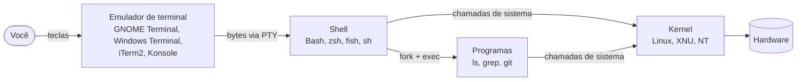
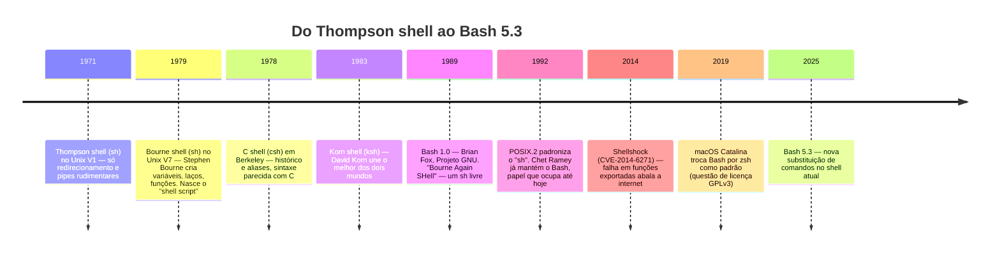

# Módulo 00 — Boas-vindas e Fundamentos

> *"Antes de digitar o primeiro comando, entenda com quem você está conversando."*

**Carga sugerida:** 3–4 h · **Nível:** zero absoluto · **Pré-requisito:** nenhum

## 🎯 Ao final deste módulo você será capaz de

- Explicar a diferença entre **kernel, terminal, emulador de terminal, shell e Bash**
- Contar a história que levou do Thompson shell (1971) ao Bash 5.3 (2025), e por que ela importa até hoje
- Escolher entre Bash, sh, zsh, fish e PowerShell com argumentos técnicos
- Instalar/acessar o Bash no Linux, macOS e Windows
- Montar um **ambiente seguro** para errar à vontade
- Usar `man`, `help`, `--help`, `type` e `info` para nunca mais depender de "decorar"

---

## 1. Quem é quem: as camadas entre você e o hardware

Quando você digita `ls` e aperta Enter, pelo menos cinco peças diferentes trabalham juntas. Confundir essas peças é a origem de metade das dúvidas de iniciante ("meu terminal não reconhece o comando" — não é o terminal, é o shell).



| Peça | O que é | Analogia |
|---|---|---|
| **Kernel** | O núcleo do sistema operacional; o único que fala direto com o hardware | O motor do carro |
| **Terminal** (histórico) | Equipamento físico: teclado + tela (ou impressora!) ligados a um computador central | O painel do carro |
| **Emulador de terminal** | Programa gráfico que *imita* aquele equipamento físico | Um simulador do painel |
| **Shell** | Programa que **lê** o que você digita, **interpreta** e **manda executar** | O motorista que traduz "vire à esquerda" em movimentos |
| **Bash** | *Um* shell específico, o mais difundido do mundo Linux | Um motorista específico, muito experiente |

**Por que isso importa na prática?**
- Atalhos como `Ctrl+Shift+C` (copiar) são do **emulador**. Atalhos como `Ctrl+R` (buscar no histórico) são do **shell** (via biblioteca Readline).
- Se você troca de emulador (de GNOME Terminal para Kitty), seus scripts continuam iguais. Se troca de shell (de Bash para zsh), alguns scripts podem quebrar.
- "Tela preta" não é um sistema: é um **programa** (o shell) esperando você falar com ele.

> 💡 **TTY** vem de *teletypewriter* (teletipo). Os primeiros terminais Unix eram literalmente máquinas de escrever conectadas por fio. É por isso que o Linux chama os consoles de `/dev/tty1`, `/dev/tty2`… e os terminais virtuais de `/dev/pts/0` (*pseudo-terminal slave*). Rode `tty` no seu terminal agora.

---

## 2. Uma história em 9 datas

Entender a história explica *por que* o Bash tem tantas "esquisitices": ele carrega 50 anos de compatibilidade.



**Os quatro fatos que você vai usar o curso inteiro:**

1. **O nome é uma piada.** *Bourne Again SHell* = "Born Again", o Bourne shell renascido como software livre. O Projeto GNU precisava de um `sh` livre para compor um sistema operacional livre.
2. **Compatibilidade com `sh` é sagrada.** Quase todo script `sh` roda no Bash. O contrário **não** é verdade: o Bash adicionou `[[ ]]`, arrays, `local`, `<<<` e muito mais. Isso é o tema da portabilidade (Módulo 11).
3. **Por que o macOS mudou?** O Bash passou para a licença GPLv3 na versão 4.0 (2009). A Apple não distribui software GPLv3, então congelou o Bash em **3.2** (2007) e depois adotou o zsh. Resultado: um Mac "de fábrica" tem um Bash de quase 20 anos. Vários recursos deste curso (arrays associativos, `${var^^}`, `mapfile`) **não existem** no Bash 3.2.
4. **Shellshock** mostrou que o shell é **superfície de ataque**. Servidores web passavam cabeçalhos HTTP para variáveis de ambiente, e o Bash executava código escondido nelas. Segurança em scripts não é paranoia (Módulo 11).

> 🆕 **Bash 5.3 (julho de 2025)** trouxe `${ comando; }`: uma substituição de comando que roda **no shell atual**, sem criar subshell. Isso significa que ela pode alterar variáveis do script — algo impossível com `$(...)`. Também chegaram `source -p CAMINHO` e `read -E`. Verifique sua versão com `bash --version`; distribuições estáveis podem ainda estar na 5.2.

---

## 3. Bash e seus vizinhos: quando usar cada um

| Shell | Ponto forte | Ponto fraco | Use quando… |
|---|---|---|---|
| **sh** (dash, ash, busybox) | Mínimo, rápido, POSIX puro, presente em qualquer Unix | Sem arrays, sem `[[ ]]` | Scripts de boot, containers Alpine, máxima portabilidade |
| **Bash** | Onipresente no Linux, enorme base de scripts e documentação | Sintaxe com armadilhas históricas | **Automação de servidores, DevOps, CI/CD — o padrão de fato** |
| **zsh** | Interatividade incrível, plugins (Oh My Zsh), globbing poderoso | Arrays começam em 1, diferenças sutis | Seu shell de uso diário (especialmente no macOS) |
| **fish** | Amigável, autossugestão, cores de fábrica | **Não é compatível com sh** | Uso interativo de quem não escreve scripts |
| **PowerShell** | Passa **objetos** entre comandos (não texto), integração Windows | Verboso, menos presente em servidores Linux | Administração Windows/Azure/AD |

**Regra de bolso:** *interativo* → use o que te deixar mais feliz. *Script que outra pessoa ou outra máquina vai rodar* → Bash (ou sh, se precisar rodar em qualquer lugar).

---

## 4. Instalando e acessando o Bash

### 🐧 Linux
Já vem instalado. Verifique:
```bash
echo "$SHELL"        # shell de login configurado para seu usuário
echo "$BASH_VERSION" # versão do Bash que está rodando AGORA (vazio = não é Bash)
bash --version
```
> ⚠️ `$SHELL` diz qual é o seu shell **padrão**, não qual está rodando. Se você abriu um `zsh` dentro de um Bash, `$SHELL` continua dizendo `/bin/bash`. Para saber o shell atual: `ps -p $$`.

### 🍎 macOS
O shell padrão é o zsh, e o `/bin/bash` é a versão 3.2. Instale um Bash moderno com [Homebrew](https://brew.sh):
```bash
brew install bash
/opt/homebrew/bin/bash --version     # Apple Silicon (Intel: /usr/local/bin/bash)
```
Para usar no dia a dia, basta digitar `bash` no zsh. Para torná-lo padrão: adicione o caminho em `/etc/shells` e rode `chsh -s /opt/homebrew/bin/bash`. Em scripts, use `#!/usr/bin/env bash` (Módulo 04) para que o Bash novo seja encontrado pelo `PATH`.

### 🪟 Windows — três caminhos

| Opção | O que é | Recomendado para |
|---|---|---|
| **WSL2** | Um Linux de verdade (kernel real) rodando no Windows | ⭐ **Este curso.** Tudo funciona igual a um servidor |
| **Git Bash** | Bash + ferramentas GNU portadas (MSYS2), vem com o Git for Windows | Uso rápido, Git no dia a dia |
| **MSYS2 / Cygwin** | Ambientes POSIX completos sobre o Windows | Compilar software Unix no Windows |

**WSL2 em um comando** (PowerShell como administrador):
```powershell
wsl --install            # instala o WSL2 com Ubuntu
# reinicie, abra "Ubuntu" no menu Iniciar, crie seu usuário e senha
```

> ⚠️ **A armadilha nº 1 do Windows: fim de linha.** O Windows termina linhas com `\r\n` (CRLF); o Linux com `\n` (LF). Um script salvo com CRLF falha com erros bizarros como `$'\r': command not found`. Este repositório já força LF via `.gitattributes`, mas configure seu editor (VS Code: canto inferior direito → "LF"). Para consertar um arquivo: `sed -i 's/\r$//' script.sh`.

---

## 5. Seu laboratório: um lugar seguro para errar

Você **vai** errar. Vai apagar o que não devia, travar o terminal com um laço infinito, sobrescrever um arquivo. Isso é aprendizado — desde que aconteça num lugar descartável.

| Ambiente | Isolamento | Como |
|---|---|---|
| **Container Docker deste curso** | ⭐⭐⭐ total | `./laboratorio/entrar.sh` (veja [laboratorio/](../../laboratorio/README.md)) |
| Máquina virtual | ⭐⭐⭐ total, com snapshots | VirtualBox/VMware + Ubuntu Server ou Debian |
| WSL2 | ⭐⭐ separado do Windows | `wsl --install` |
| Diretório de testes | ⭐ só disciplina | `mkdir -p ~/lab-bash && cd ~/lab-bash` |

> 🛡️ **Regra de ouro do curso:** todos os exemplos deste repositório que criam ou apagam arquivos fazem isso dentro de um diretório temporário criado com `mktemp -d` e removido no final. Você pode rodá-los sem medo. Quando *você* escrever scripts que apagam coisas, faça o mesmo.

---

## 6. Convenções deste curso

```console
$ comando         # "$ " = prompt de usuário comum. NÃO digite o "$"
# comando         # "# " = prompt de root (administrador). Cuidado redobrado
saída do comando  # linhas sem prompt são o que o comando imprime
```

| Marcador | Significado |
|---|---|
| 💡 | Dica, curiosidade, contexto |
| ⚠️ | Armadilha comum — leia com atenção |
| 🔥 | **Perigo**: pode destruir dados. Só rode no laboratório |
| 🆕 | Recurso de versões recentes do Bash (pode não existir na sua) |
| 🧪 | Exemplo executável neste repositório |
| 🏋️ | Exercício com correção automática |

---

## 7. Como pedir ajuda (e parar de decorar)

O profissional não decora opções: ele sabe **onde procurar** em 10 segundos.

| Comando | Para quê | Exemplo |
|---|---|---|
| `type cmd` | **Primeiro passo sempre.** Diz *o que* é o comando | `type cd` → *cd is a shell builtin* |
| `help cmd` | Ajuda de **builtins** do Bash (`cd`, `read`, `test`…) | `help read` |
| `man cmd` | Manual completo de **programas** externos | `man ls` |
| `cmd --help` | Resumo rápido embutido no programa | `ls --help \| less` |
| `info cmd` | Documentação GNU em hipertexto (mais detalhada que o man) | `info coreutils` |
| `apropos palavra` | "Qual comando faz…?" — busca nas descrições do man | `apropos compress` |
| `man bash` | O manual do próprio Bash — a fonte da verdade | `/Parameter Expansion` dentro dele |

**Por que `type` primeiro?** Porque `help` só funciona para builtins e `man` só para programas. `type -a echo` mostra que existem **dois** `echo`: o builtin do Bash e o `/usr/bin/echo`. Eles têm opções diferentes!

**Lendo um man sem surtar** (detalhes em [referencia/ler-o-man.md](../../referencia/ler-o-man.md)):
- `/texto` busca, `n` próximo resultado, `q` sai
- Na **SYNOPSIS**: `[ ]` = opcional, `...` = pode repetir, `a|b` = um ou outro
- Pule direto para **EXAMPLES** quando existir

---

## 🧪 Exemplos deste módulo

| Arquivo | O que demonstra |
|---|---|
| [01-ola-mundo.sh](exemplos/01-ola-mundo.sh) | Anatomia mínima de um script e as três formas de executá-lo |
| [02-tres-formas-de-executar.sh](exemplos/02-tres-formas-de-executar.sh) | `bash script`, `./script` e `source script`: quem herda o quê |
| [03-o-que-e-este-comando.sh](exemplos/03-o-que-e-este-comando.sh) | `type`, `help`, `command -v`: classificando comandos |

```bash
bash modulos/00-boas-vindas-e-fundamentos/exemplos/02-tres-formas-de-executar.sh
```

## ⚠️ Armadilhas do módulo

- Confiar em `$SHELL` para saber o shell atual (use `ps -p $$` ou `$BASH_VERSION`)
- Rodar scripts com CRLF vindos do Windows (`$'\r': command not found`)
- Testar recursos modernos no Bash 3.2 do macOS e achar que "o curso está errado"
- Praticar como **root** no seu computador pessoal

## 🏋️ Exercícios

Veja [exercicios/README.md](exercicios/README.md). Corrija com:
```bash
./ferramentas/corrigir.sh 00
```

## ✅ Checklist de domínio

- [ ] Sei desenhar o caminho tecla → emulador → shell → kernel
- [ ] Sei por que o macOS tem um Bash de 2007
- [ ] Sei a diferença entre `$SHELL` e `$BASH_VERSION`
- [ ] Tenho um ambiente seguro funcionando
- [ ] Uso `type` antes de `help`/`man`

---

⬅️ [Início](../../README.md) · ➡️ [Módulo 01 — Sobrevivência no Terminal](../01-sobrevivencia-no-terminal/README.md)

<sub>© 2026 Prof. Daniel Santos · Texto sob [CC BY-NC-SA 4.0](../../LICENSE-CONTEUDO.md) · Código sob [MIT](../../LICENSE)</sub>
