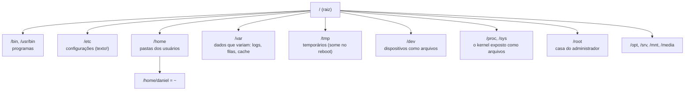

# Módulo 01 — Sobrevivência no Terminal

> *"A interface gráfica mostra o que alguém decidiu que você precisa ver. O terminal mostra tudo."*

**Carga sugerida:** 4–5 h · **Pré-requisito:** [Módulo 00](../00-boas-vindas-e-fundamentos/README.md)

## 🎯 Objetivos

- Entender a **árvore única** de diretórios do Linux (FHS) e por que não existe "C:"
- Navegar com caminhos **absolutos e relativos** sem se perder
- Criar, copiar, mover, renomear e apagar arquivos — com segurança
- Ler arquivos de qualquer tamanho (`cat`, `less`, `head`, `tail`, `wc`)
- Encontrar qualquer coisa (`find`, `locate`, `which`, `command -v`)
- Ser **rápido**: atalhos do Readline e histórico

---

## 1. Uma árvore, uma raiz

No Windows cada disco é uma árvore (`C:\`, `D:\`). No Linux existe **uma única árvore** começando em `/` (a raiz). Discos, pendrives e até sistemas de arquivos virtuais são *montados* em algum galho dela.

| Diretório | Por que existe | Você vai mexer quando… |
|---|---|---|
| `/etc` | Toda configuração do sistema é **texto puro** — editável com q