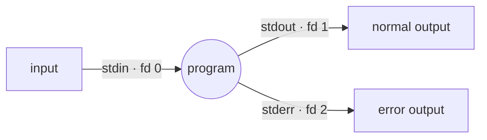

# Module 02 — The Heart of Bash: Data Flow

> *"Write programs that do one thing and do it well. Write programs to work together. Write programs to handle text streams, because that is a universal interface."* — Doug McIlroy, the Unix philosophy

**🌍 Idioma / Language:** [Português](README.md) · **English**

> 🌐 *Community translation. Spotted a slip or have a better wording? [Open an issue or PR](https://github.com/dsantos-docencia/Bash/issues) — see [traducoes/](../../traducoes/README.en.md).*

**Suggested time:** 5–7 h · **Level:** beginner+ · **Prerequisite:** [Module 01](../01-sobrevivencia-no-terminal/README.en.md)

## 🎯 Objectives

- Understand the three streams: `stdin`, `stdout`, `stderr`
- Redirect input and output (`>`, `>>`, `<`, `2>`, `&>`)
- Chain commands with **pipes** (`|`) — the shell's superpower
- Use `/dev/null`, the "black hole"
- Expand names with **globbing** (`*`, `?`, `[]`, `{}`)
- Master the **history** (`!!`, `!$`, `Ctrl+R`)

---

## 1. The three streams: the idea that makes everything work

Every Unix program is born with three "pipes" connected:



| Stream | Number (fd) | What it is | Goes to (default) |
|---|---|---|---|
| **stdin** | 0 | data input | your keyboard |
| **stdout** | 1 | normal output | your screen |
| **stderr** | 2 | **error** messages | your screen |

**Why separate stdout from stderr?** So you can **save the result** and **see the errors** at the same time — or discard one without losing the other. A well-built program sends data to stdout and complaints to stderr.

## 2. Redirection: changing where the pipes point

| Operator | Does |
|---|---|
| `cmd > arq` | stdout **overwrites** `arq` |
| `cmd >> arq` | stdout is **appended** to the end of `arq` |
| `cmd < arq` | stdin comes from `arq` (instead of the keyboard) |
| `cmd 2> arq` | stderr goes to `arq` |
| `cmd > out 2> err` | stdout and stderr in **separate** files |
| `cmd > tudo 2>&1` | stderr follows stdout (both in `tudo`) |
| `cmd &> tudo` | Bash shortcut for the above |
| `cmd 2>/dev/null` | **discards** the errors |

```bash
ls /existe /naoexiste > saida.txt 2> erros.txt
#          ↑ goes to saida.txt    ↑ goes to erros.txt

make &> compilacao.log      # saves EVERYTHING (output + errors) in a log
./script 2>/dev/null        # I only want the output; silence the errors
```

> ⚠️ **Order matters in `2>&1`.** `cmd > arq 2>&1` works (stdout goes to the file, then stderr follows stdout → file). But `cmd 2>&1 > arq` does **not**: stderr is pointed at the screen *before* stdout switches to the file. Read it as "copy the current destination": `2>&1` = "fd 2 goes where fd 1 is **now**".

### `/dev/null` — the black hole

A special file that **discards** everything it receives and is always empty on read.

```bash
comando > /dev/null          # I don't want to see the output
comando 2> /dev/null         # I don't want to see the errors
comando &> /dev/null         # total silence
comando < /dev/null          # empty input (the command "waits" for nothing)
```

## 3. Pipes: the assembly line

A pipe `|` connects the **stdout** of one command to the **stdin** of the next. That's how you build text "assembly lines".

```bash
cat acesso.log | grep "ERRO" | sort | uniq -c | sort -rn | head
#   reads the log  only the      sorts  counts    sorts by   top 10
#                  lines w/ ERRO         duplicates number (desc)
```

Each piece does **one** thing. Together, they answer "what are the 10 most frequent errors?". That's the Unix philosophy in action.

```bash
ls -l | wc -l                 # how many items are in the folder?
ps aux | grep firefox         # firefox processes
cut -d: -f1 /etc/passwd | sort # usernames, in order
```

> 💡 A pipe creates **subshells** running in parallel. That has a famous consequence (Module 06): `echo x | read var` does **not** change `var` outside the pipe, because the `read` runs in a subshell. Keep this one; it catches everyone once.

## 4. Globbing: the shell expands names for you

Before running the command, the **shell** replaces patterns with real file names. The command receives the already-expanded names.

| Pattern | Matches |
|---|---|
| `*` | any sequence (including empty) — `*.txt` |
| `?` | **one** arbitrary character — `arq?.log` |
| `[abc]` | one character among those listed |
| `[a-z]` | one character in the range |
| `[!abc]` or `[^abc]` | one character **outside** the list |
| `{a,b,c}` | brace expansion: generates `a b c` (doesn't need to exist!) |

```bash
ls *.txt                 # all the .txt
ls relatorio-??.pdf      # relatorio-01.pdf, relatorio-02.pdf…
ls foto[0-9].jpg         # foto0.jpg … foto9.jpg
cp arquivo.{txt,bak}     # expands to: cp arquivo.txt arquivo.bak  — NO; see below
echo img.{png,jpg,gif}   # img.png img.jpg img.gif
mkdir -p projeto/{src,test,docs}   # creates the three subfolders at once
```

> ⚠️ **Glob ≠ regex!** In the shell, `*` means "anything"; in a regex (grep/sed), `*` means "zero or more of the previous". They're different languages. Regex comes in Module 05.

> ⚠️ If a glob **matches** nothing, by default Bash leaves it **literal**: `ls *.xyz` with no `.xyz` runs `ls '*.xyz'` and errors. The option `shopt -s nullglob` makes the glob become empty in that case (Module 05).

### Braces `{}` vs. globs

- `*`, `?`, `[]` **look at the disk** and only match files that **exist**.
- `{a,b}` is pure **text generation**, done **beforehand**, nothing needs to exist.

```bash
touch pagina-{01..10}.html    # creates pagina-01.html … pagina-10.html (a sequence!)
echo {A..E}                   # A B C D E
```

## 5. History: never retype

| Shortcut / command | Does |
|---|---|
| `↑` / `↓` | navigate previous commands |
| `Ctrl+R` | **reverse search** — type part of the command and it appears |
| `history` | lists the numbered history |
| `!!` | repeats the **last** command |
| `!42` | repeats command #42 |
| `!grep` | repeats the last one that started with "grep" |
| `!$` | the **last argument** of the previous command |
| `!*` | **all** arguments of the previous command |

```bash
mkdir /opt/app/config
cd !$               # becomes: cd /opt/app/config

apt install nginx   # "permission denied"
sudo !!             # becomes: sudo apt install nginx
```

> 💡 `Ctrl+R` is probably the shortcut that saves the most time in the terminal. Start using it today: `Ctrl+R`, type `ssh`, see your last `ssh ...` appear, `Enter`.

---

## 🧪 Examples in this module

| File | Demonstrates |
|---|---|
| [01-fluxos-e-redirecionamento.sh](exemplos/01-fluxos-e-redirecionamento.sh) | stdout vs stderr, `>`/`>>`/`2>`/`&>`, and `/dev/null` |
| [02-pipes-filosofia-unix.sh](exemplos/02-pipes-filosofia-unix.sh) | An assembly line that extracts a ranking from a log |
| [03-globbing.sh](exemplos/03-globbing.sh) | `*`, `?`, `[]`, `{}`, and the difference between braces and globs |

## ⚠️ Module pitfalls

- Reversing the order in `2>&1` and not capturing the errors
- Expecting `echo x | read var` to change `var` (subshell!)
- Confusing glob (`*` = anything) with regex (`*` = repetition)
- `>` overwriting an important file (you wanted `>>`)
- A non-matching glob becoming literal text and erroring

## 🏋️ Exercises

See [exercicios/README.en.md](exercicios/README.en.md). Grade with `./ferramentas/corrigir.sh 02`.

## ✅ Mastery checklist

- [ ] I separate stdout from stderr and know why that's useful
- [ ] I write `cmd > out 2> err` and `cmd &> tudo` without thinking
- [ ] I build an assembly line with pipes
- [ ] I know the difference between `{a,b}` and `*`
- [ ] I use `Ctrl+R` and `!$` day to day

---

⬅️ [Module 01](../01-sobrevivencia-no-terminal/README.en.md) · ➡️ [Module 03 — First Scripts](../03-primeiros-scripts/README.en.md)

<sub>© 2026 Prof. Daniel Santos and translators · Content [CC BY-NC-SA 4.0](../../LICENSE-CONTEUDO.md) · Code [PolyForm NC](../../LICENSE)</sub>
