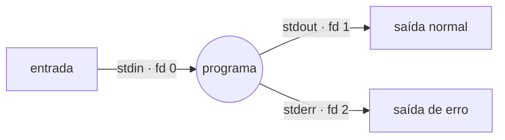

# Módulo 02 — O Coração do Bash: Fluxo de Dados

> *"Escreva programas que façam uma coisa e a façam bem. Escreva programas que trabalhem juntos. Escreva programas que manipulem fluxos de texto, porque essa é uma interface universal."* — Doug McIlroy, a filosofia Unix

**Carga sugerida:** 5–7 h · **Nível:** iniciante+ · **Pré-requisito:** [Módulo 01](../01-sobrevivencia-no-terminal/)

## 🎯 Objetivos

- Entender os três fluxos: `stdin`, `stdout`, `stderr`
- Redirecionar entrada e saída (`>`, `>>`, `<`, `2>`, `&>`)
- Encadear comandos com **pipes** (`|`) — o superpoder do shell
- Usar `/dev/null`, o "buraco negro"
- Expandir nomes com **globbing** (`*`, `?`, `[]`, `{}`)
- Dominar o **histórico** (`!!`, `!$`, `Ctrl+R`)

---

## 1. Os três fluxos: a ideia que faz tudo funcionar

Todo programa Unix nasce com três "canos" conectados:



| Fluxo | Número (fd) | O que é | Vai para (padrão) |
|---|---|---|---|
| **stdin** | 0 | entrada de dados | seu teclado |
| **stdout** | 1 | saída normal | sua tela |
| **stderr** | 2 | mensagens de **erro** | sua tela |

**Por que separar stdout de stderr?** Para você poder **guardar o resultado** e **ver os erros** ao mesmo tempo — ou descartar um sem perder o outro. Um programa bem-feito manda dados para o stdout e reclamações para o stderr.

## 2. Redirecionamento: mudando para onde os canos apontam

| Operador | Faz |
|---|---|
| `cmd > arq` | stdout **sobrescreve** `arq` |
| `cmd >> arq` | stdout é **acrescentado** ao fim de `arq` |
| `cmd < arq` | stdin vem de `arq` (em vez do teclado) |
| `cmd 2> arq` | stderr vai para `arq` |
| `cmd > out 2> err` | stdout e stderr em arquivos **separados** |
| `cmd > tudo 2>&1` | stderr segue o stdout (ambos em `tudo`) |
| `cmd &> tudo` | atalho do Bash para o anterior |
| `cmd 2>/dev/null` | **descarta** os erros |

```bash
ls /existe /naoexiste > saida.txt 2> erros.txt
#          ↑ vai p/ saida.txt    ↑ vai p/ erros.txt

make &> compilacao.log      # guarda TUDO (saída + erros) num log
./script 2>/dev/null        # só quero a saída; silencie os erros
```

> ⚠️ **A ordem importa em `2>&1`.** `cmd > arq 2>&1` funciona (stdout vai pro arquivo, depois stderr segue o stdout → arquivo). Mas `cmd 2>&1 > arq` **não**: o stderr é apontado para a tela *antes* de o stdout mudar para o arquivo. Leia como "copie o destino atual": `2>&1` = "fd 2 vai para onde o fd 1 está **agora**".

### `/dev/null` — o buraco negro

Um arquivo especial que **descarta** tudo que recebe e está sempre vazio na leitura.

```bash
comando > /dev/null          # não quero ver a saída
comando 2> /dev/null         # não quero ver os erros
comando &> /dev/null         # silêncio total
comando < /dev/null          # entrada vazia (o comando "não espera" nada)
```

## 3. Pipes: a linha de montagem

Um pipe `|` conecta o **stdout** de um comando ao **stdin** do próximo. É assim que se montam "linhas de montagem" de texto.

```bash
cat acesso.log | grep "ERRO" | sort | uniq -c | sort -rn | head
#   lê o log    só as linhas   ordena  conta    ordena por   top 10
#               com ERRO               repetidas  nº (desc)
```

Cada peça faz **uma** coisa. Juntas, respondem "quais os 10 erros mais frequentes?". Isso é a filosofia Unix na veia.

```bash
ls -l | wc -l                 # quantos itens há na pasta?
ps aux | grep firefox         # processos do firefox
cut -d: -f1 /etc/passwd | sort # nomes de usuários, em ordem
```

> 💡 Um pipe cria **subshells** rodando em paralelo. Isso tem uma consequência famosa (Módulo 06): `echo x | read var` **não** altera `var` fora do pipe, porque o `read` roda num subshell. Guarde essa; ela pega todo mundo uma vez.

## 4. Globbing: o shell expande nomes para você

Antes de rodar o comando, o **shell** troca padrões por nomes de arquivos reais. Quem recebe os nomes já expandidos é o comando.

| Padrão | Casa com |
|---|---|
| `*` | qualquer sequência (inclusive vazia) — `*.txt` |
| `?` | **um** caractere qualquer — `arq?.log` |
| `[abc]` | um caractere entre os listados |
| `[a-z]` | um caractere no intervalo |
| `[!abc]` ou `[^abc]` | um caractere **fora** da lista |
| `{a,b,c}` | expansão de chaves: gera `a b c` (não precisa existir!) |

```bash
ls *.txt                 # todos os .txt
ls relatorio-??.pdf      # relatorio-01.pdf, relatorio-02.pdf…
ls foto[0-9].jpg         # foto0.jpg … foto9.jpg
cp arquivo.{txt,bak}     # expande para: cp arquivo.txt arquivo.bak  — NÃO; veja abaixo
echo img.{png,jpg,gif}   # img.png img.jpg img.gif
mkdir -p projeto/{src,test,docs}   # cria as três subpastas de uma vez
```

> ⚠️ **Glob ≠ regex!** No shell, `*` significa "qualquer coisa"; numa regex (grep/sed), `*` significa "zero ou mais do anterior". São linguagens diferentes. Regex vem no Módulo 05.

> ⚠️ Se um glob **não casa** nada, por padrão o Bash o deixa **literal**: `ls *.xyz` com nenhum `.xyz` roda `ls '*.xyz'` e dá erro. A opção `shopt -s nullglob` faz o glob virar vazio nesse caso (Módulo 05).

### Chaves `{}` vs. globs

- `*`, `?`, `[]` **olham o disco** e só casam arquivos que **existem**.
- `{a,b}` é pura **geração de texto**, feita **antes**, não precisa existir nada.

```bash
touch pagina-{01..10}.html    # cria pagina-01.html … pagina-10.html (sequência!)
echo {A..E}                   # A B C D E
```

## 5. Histórico: nunca redigite

| Atalho / comando | Faz |
|---|---|
| `↑` / `↓` | navega nos comandos anteriores |
| `Ctrl+R` | **busca reversa** — digite parte do comando e ele aparece |
| `history` | lista o histórico numerado |
| `!!` | repete o **último** comando |
| `!42` | repete o comando nº 42 |
| `!grep` | repete o último que começou com "grep" |
| `!$` | o **último argumento** do comando anterior |
| `!*` | **todos** os argumentos do comando anterior |

```bash
mkdir /opt/app/config
cd !$               # vira: cd /opt/app/config

apt install nginx   # "permission denied"
sudo !!             # vira: sudo apt install nginx
```

> 💡 `Ctrl+R` é provavelmente o atalho que mais economiza tempo no terminal. Comece a usá-lo hoje: `Ctrl+R`, digite `ssh`, veja seu último `ssh ...` aparecer, `Enter`.

---

## 🧪 Exemplos deste módulo

| Arquivo | Demonstra |
|---|---|
| [01-fluxos-e-redirecionamento.sh](exemplos/01-fluxos-e-redirecionamento.sh) | stdout vs stderr, `>`/`>>`/`2>`/`&>` e `/dev/null` |
| [02-pipes-filosofia-unix.sh](exemplos/02-pipes-filosofia-unix.sh) | Uma linha de montagem que extrai um ranking de um log |
| [03-globbing.sh](exemplos/03-globbing.sh) | `*`, `?`, `[]`, `{}` e a diferença entre chaves e globs |

## ⚠️ Armadilhas do módulo

- Inverter a ordem em `2>&1` e não capturar os erros
- Esperar que `echo x | read var` altere `var` (subshell!)
- Confundir glob (`*` = qualquer coisa) com regex (`*` = repetição)
- `>` sobrescrever um arquivo importante (queria `>>`)
- Glob sem correspondência virar texto literal e dar erro

## 🏋️ Exercícios

Veja [exercicios/README.md](exercicios/README.md). Corrija com `./ferramentas/corrigir.sh 02`.

## ✅ Checklist de domínio

- [ ] Separo stdout de stderr e sei por que isso é útil
- [ ] Escrevo `cmd > out 2> err` e `cmd &> tudo` sem pensar
- [ ] Monto uma linha de montagem com pipes
- [ ] Sei a diferença entre `{a,b}` e `*`
- [ ] Uso `Ctrl+R` e `!$` no dia a dia

---

⬅️ [Módulo 01](../01-sobrevivencia-no-terminal/README.md) · ➡️ [Módulo 03 — Primeiros Scripts](../03-primeiros-scripts/README.md)

<sub>© 2026 Prof. Daniel Santos · Conteúdo [CC BY-NC-SA 4.0](../../LICENSE-CONTEUDO.md) · Código [MIT](../../LICENSE)</sub>
